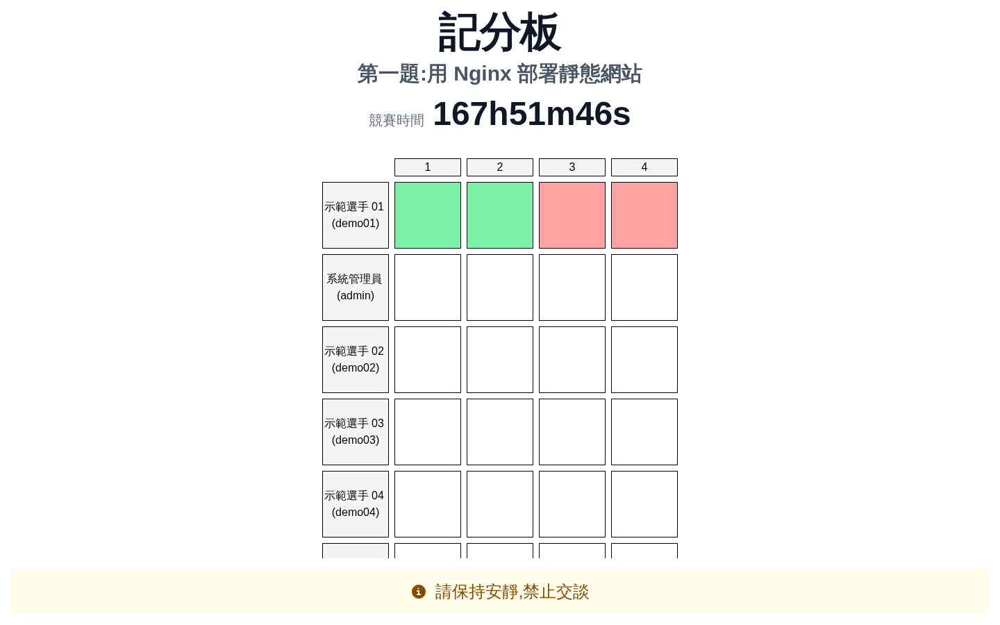
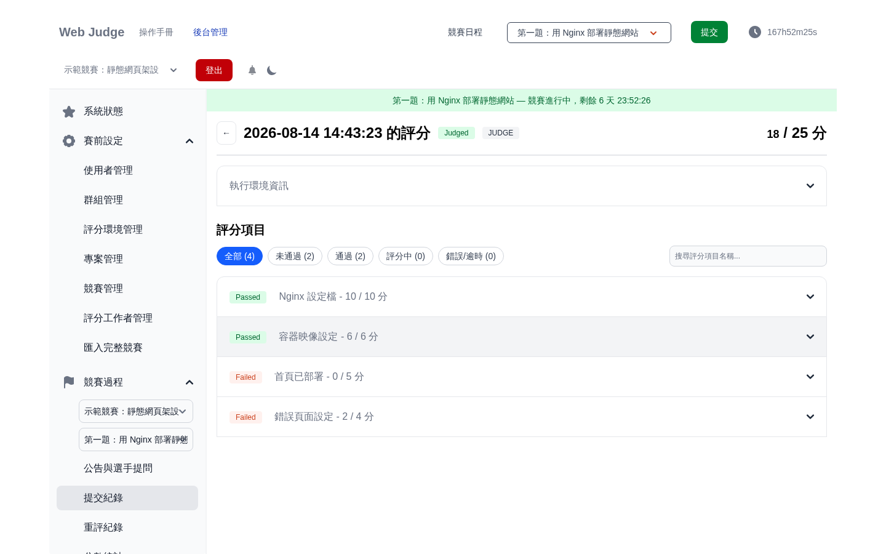
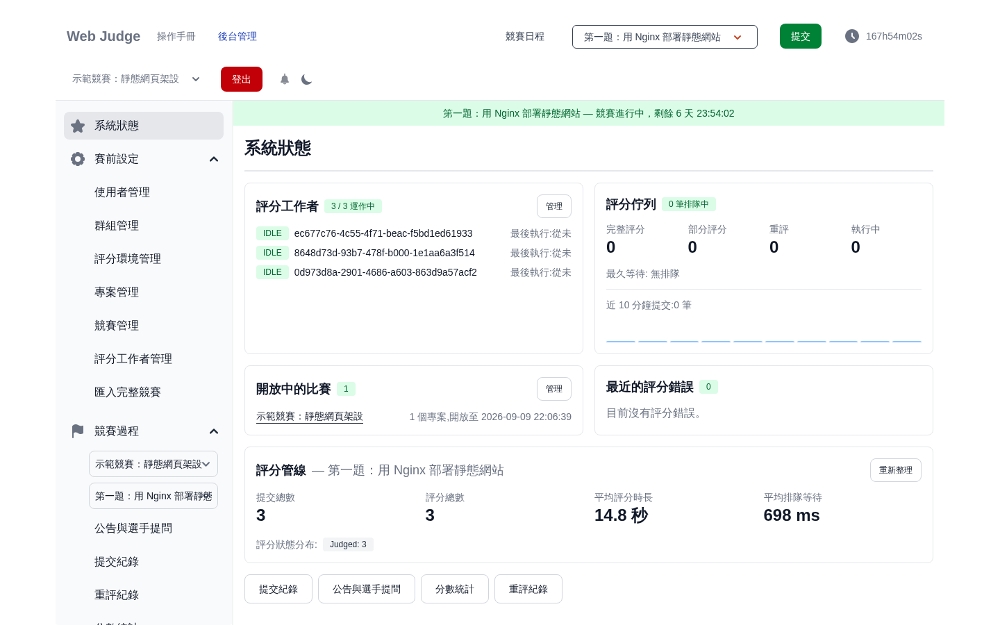

# Web Judge

技能競賽用的 Web 專案評測系統 — 選手上傳完整的網站專案(zip),系統在容器中啟動並逐項評分,即時更新記分板。

*A self-hosted Online Judge platform for evaluating web-based projects, designed for skill competitions.*

[](https://github.com/LaiJunBin/web-oj/actions/workflows/backend-ci.yml)
[](https://github.com/LaiJunBin/web-oj/actions/workflows/frontend-ci.yml)
[](https://github.com/LaiJunBin/web-oj/actions/workflows/spec-check.yml)



<p align="center"><sub>會場大螢幕用的記分板。下方跑馬公告與標題皆可自訂,場次以網址鎖定。</sub></p>

## 特色

- **評測真實專案,不只程式碼片段**:提交的是完整網站,評測在隔離容器中實際啟動它,逐評分項、逐測資計分(支援加分制/扣分制、隱藏測資、部分提交)。
- **即時性**:倒數計時、記分板、提交狀態、後台監控全部走 SSE,不用重新整理。
- **比賽現場導向**:kiosk 大螢幕記分板(場次鎖定、自訂標題與跑馬公告)、後台「系統狀態」指揮台(評分工作者健康度、佇列深度與最久等待、即時錯誤清單)、重評流程(進度追蹤、前後比對、審核採計)。
- **內建雙操作手冊**:選手手冊(`/manual`)與管理端手冊(`/dashboard/reference`),皆附實際畫面截圖。
- **開箱即示範**:seed 內建一場進行中的示範競賽,clone 下來即可走完「登入 → 提交 → 評分 → 記分板」全流程(見下方快速上手)。

| 逐評分項的評測結果 | 後台「系統狀態」指揮台 |
|---|---|
| [](frontend/static/reference/judgment.png) | [](frontend/static/reference/status.png) |
| 每個評分項獨立計分,點開可看該項各測資的指令與輸出。 | 工作者狀態、佇列深度與最久等待、平均評分時長,全部即時更新。 |

> 上面這場比賽就是 seed 內建的示範資料——按下方快速上手裝起來,看到的畫面與截圖相同。

## 系統架構

```
typespec/          API 規格(單一事實來源)
   │  tsp build → openapi.yaml
   ├────────────► backend/api(oapi-codegen 產生 Go server 介面)
   └────────────► frontend/src/api(openapi-zod-client 產生 typed client)

frontend/          SvelteKit 2 + Svelte 5(runes)+ Tailwind
                   ├─ 瀏覽器直呼後端 REST(VITE_API_URL)
                   └─ SSE 走同源 /api/stream/* 由 SvelteKit server 代理彙整
backend/           Go(clean architecture + fx DI)
                   ├─ MySQL(關聯資料)/ MongoDB(提交與評分)/ Redis(refresh token)
                   └─ judge workers(goroutine 池)透過 Docker 啟動評測容器
```

- **API-first**:改規格一律從 `typespec/` 開始(`npm run build`),再分別重新產生前後端程式碼;手寫兩端 DTO 是不允許的。
- **前端 BFF**:SSE 由 SvelteKit server route 代理,將多條後端串流多工成單一連線,並轉發自動續期的 auth cookie。
- **評分管線**:提交入列 → worker 取出 → 以專案映像啟動容器、解壓提交 → 逐測資執行指令 → 依計分策略彙總 → SSE 推播結果與記分板。

## 快速上手

需求:Docker + Docker Compose、Node.js **22.13+** 與 pnpm 11(前端;`corepack enable`
會依 `packageManager` 欄位自動選對版本)、Go 1.23+(後端本機模式;版本以 `backend/go.mod` 為準)。
後端的金鑰腳本(`make generate:keys`)另需 `make`、`bash` 與 `openssl`,且使用 GNU
`sed -i` 語法——macOS 內建的 BSD sed 會失敗,請在 Linux 或 dev container 內執行。

> 不想在主機安裝工具鏈?`backend/` 與 `frontend/` 各附 **VS Code Dev Container**
> (`.devcontainer/`):以 VS Code 開啟對應子目錄後「Reopen in Container」,即可在
> 隔離環境中取得完整工具鏈(主機只需要 Docker)。

```bash
git clone --recurse-submodules <repo-url>   # 前端含兩個 git submodule
# 已經用普通 clone 拉下來了?補跑:git submodule update --init
```

**1. 後端**(詳細步驟與各啟動模式見 [backend/README.md](backend/README.md)):

```bash
cd backend
cp config.example.yaml config.yaml
make generate:keys        # 產生 app/jwt/csrf/store 四把金鑰寫入 config.yaml
docker compose up -d      # 起 app + mysql + mongo + redis(+ mongo-express)
docker compose exec app make migrate
docker compose exec app make seed
```

**2. 前端**(細節與常見錯誤見 [frontend/README.md](frontend/README.md)):

```bash
cd frontend
cp .env.example .env      # 預設指向 http://localhost:8080 的後端
pnpm install              # 快速上手只用到已 bundle 的 gen:api-client,毋須裝 submodule 相依
pnpm gen:api-client       # 產生 typed client(gen/ 不入庫);需 submodule 已 checkout,見上方 clone
pnpm dev                  # http://localhost:5173
```

**3. 建置示範評測映像**(首次一次即可):seed 已登錄 `test-nginx:latest` 映像但尚未建置——用 `admin / 1234` 登入後台「評分環境管理」,依 [backend/README.md](backend/README.md#建置示範映像) 用 `resources/demo/test-nginx-image/` 的內容完成建置。

**4. 走一遍示範流程**:

| 步驟 | 操作 |
|---|---|
| 登入 | 帳號 `demo01`,密碼 `1234`(示範選手 demo01~demo05,密碼皆相同) |
| 提交 | 導覽列「提交」→ 上傳 `backend/tests/data/nginx.zip`(刻意只做一半的範例作品) |
| 看評分 | 提交紀錄 → 該筆提交:**18 / 25**,四個評分項呈現通過/失敗/部分給分 |
| 記分板 | 側欄「記分板」看到格子變色;後台「記分板展示」可產生 kiosk 大螢幕連結 |
| 後台 | 改用 `admin / 1234` 登入 →「後台管理」:系統狀態、提交、重評、分數匯出 |

> 示範帳密刻意公開且簡單,僅供第一次安裝體驗;正式使用請自行建立帳號、停用示範資料(示範資料全部定義於 `backend/database/seeder/seeders/demo_data.json`)。

## 拿去辦真的比賽之前

上面的快速上手是**開發模式**——同一台機器、`pnpm dev`、示範資料。真的要在考場用,有幾個
設錯不會報錯、只會讓功能安靜地壞掉的地方,兩份 README 各有一張表把它們收在一起:

- **後端**:[正式架設前的檢查表](backend/DEPLOYMENT.md) — `env` 與 TLS 的關係、
  不要用 sqlite、API 要 `API_BIND_HOST=0.0.0.0` 才連得到、**只能跑一個 API 行程**、
  **評測容器的 CPU/記憶體上限要自己設**、**比賽期間避免重啟後端**、反向代理與登入限流、
  遠端 docker 的 mTLS
- **前端**:[正式部署(adapter-node)](frontend/README.md#正式部署adapter-node) — `ORIGIN` 必填,
  以及後端必須與前端同 hostname(或為其子網域)

漏掉其中任何一項的典型症狀是「服務起得來,但倒數凍結 / 記分板不動 / 選手連不進來 /
登入靜默失敗」,而畫面上不會有任何一句話指向設定檔。

賽後:成績以後台的「分數匯出」保存;系統本身沒有內建備份機制,需要保留完整環境
或原始資料時,請依你的部署形態自行處理(例如整機 / VM 快照)。

## 專案結構

| 路徑 | 內容 |
|---|---|
| [`typespec/`](typespec/README.md) | API 規格(SSOT);`npm run build` 產出 openapi.yaml(產物已入庫,可直接以 OpenAPI 工具瀏覽) |
| [`backend/`](backend/README.md) | Go 後端;`Makefile` 集中所有指令(migrate/seed/test/mocks/api) |
| [`frontend/`](frontend/README.md) | SvelteKit 前端;`e2e/` 為 Playwright 端對端測試 |
| [`frontend/openapi-zod-client`](https://github.com/LaiJunBin/openapi-zod-client)、[`frontend/msw-auto-mock`](https://github.com/LaiJunBin/msw-auto-mock) | git submodules(客製的產生器) |
| [`resources/`](resources/) | 範例題目素材與示範映像建置內容(皆為教學示範素材,非正式賽題) |
| [`.claude/skills/`](.claude/skills/) | 維護工作流(如手冊截圖重製)的操作手冊 |

## 測試

```bash
# 後端(於 backend/)
make test:unit                 # 單元測試
make test:feature              # godog BDD 情境測試(testcontainers 起相依服務)
make test:feature:short-ttl    # 短效期 token 自動續期的獨立情境

# 前端(於 frontend/)
pnpm run check                 # svelte-check(0 errors 為基準)
pnpm test:unit                 # vitest
pnpm test:e2e --project=smoke  # E2E 冒煙:對運行中的環境自建比賽並驗證主要動線
pnpm test:e2e --project=full   # E2E 完整:含評分管線端到端(需可評分的環境)
```

E2E 以環境變數抽換目標(`E2E_BASE_URL`、`E2E_API_URL`、帳密),`--grep @readonly`
可對正式環境跑無副作用的賽前健檢;詳見 `frontend/e2e/fixtures.ts`。

GitHub Actions 有四條 workflow:

| Workflow | 觸發 | 內容 |
|---|---|---|
| `backend-ci` | push 到 main / PR(限 `backend/**`,純文件變更除外) | build、vet、`go test -race`、gitleaks(掃全歷史) |
| `frontend-ci` | push 到 main / PR(限 `frontend/**`,純文件變更除外) | `pnpm audit`、svelte-check、vitest、build |
| `spec-check` | push 到 main / PR(限規格與其產物) | 重跑 TypeSpec,比對前後端兩份 `openapi.yaml` 是否為最新產物 |
| `e2e` | PR 到 main(限程式與規格路徑,純文件變更除外)、每日 20:00 UTC(自上次綠燈後無變更則自動跳過) | 起完整環境跑 Playwright(smoke + full,含評分管線);後端 godog feature 套件 |

四條都另外保留 `workflow_dispatch`,可在 Actions 頁面手動觸發。

## 操作手冊

- 選手:啟動前端後開 [`/manual`](http://localhost:5173/manual)
- 管理端:後台側欄「參考文件」([`/dashboard/reference`](http://localhost:5173/dashboard/reference))

## 關於本專案

本系統為國立陽明交通大學(NYCU)碩士論文的研究成果,為技能競賽的實務場景而設計,
並已在實際競賽中完整運作過一場;開源版本附完整的操作手冊與部署文件,供教育單位、
競賽主辦方與開發社群參考使用。

競賽之後開發仍持續進行,部分後續加入的功能尚未經過實際競賽檢驗。使用上遇到問題
歡迎開 Issue 回報;安全性問題請依 [SECURITY.md](SECURITY.md) 私下回報;想動手改進,
見 [CONTRIBUTING.md](CONTRIBUTING.md)。

## License

[MIT](LICENSE)。歡迎自由使用、修改與散布;送出 PR 即表示同意以相同授權貢獻。

第三方素材:`frontend/openapi-zod-client` 與 `frontend/msw-auto-mock` 為獨立
repository 的 submodule,授權依各自 `package.json` 之宣告(ISC / MIT);上游未
附授權全文。
